# ZopHop — Complete User & Architecture Manual

ZopHop is an open-source, on-device Android automation and forwarding engine. It captures incoming SMS messages, app notifications, incoming calls, or scheduled cron events; validates environmental preconditions (VPN, Internet, SIM, GPS, Battery, or multi-step HTTP health probes); runs visual multi-node workflow graphs; and securely forwards alerts to **ntfy**, **Gotify**, **Telegram**, **SMS**, **System Notifications**, and custom **HTTP Webhook** APIs.

---

## Table of Contents
1. [Architecture & Modular Project Structure](#1-architecture--modular-project-structure)
2. [Workflows & Visual Pipeline Builder](#2-workflows--visual-pipeline-builder)
3. [Complete Node Catalog (Triggers, Parsers, Logic & Actions)](#3-complete-node-catalog-triggers-parsers-logic--actions)
4. [HTTP Webhook Action & Import from cURL](#4-http-webhook-action--import-from-curl)
5. [Preconditions & Chained Check Pipelines](#5-preconditions--chained-check-pipelines)
6. [Execution Logs, Live Stepper, Queue & Cancellation](#6-execution-logs-live-stepper-queue--cancellation)
7. [Encrypted Credential Vault & Biometric Lock](#7-encrypted-credential-vault--biometric-lock)
8. [Settings, Themes, Concurrency & Portable Backups](#8-settings-themes-concurrency--portable-backups)
9. [First-Time Setup & Self-Hosted Server Guides](#9-first-time-setup--self-hosted-server-guides)
10. [Indian Banking & OTP Filter Presets](#10-indian-banking--otp-filter-presets)
11. [Testing with ADB Emulator](#11-testing-with-adb-emulator)
12. [Troubleshooting & OEM Battery Settings](#12-troubleshooting--oem-battery-settings)
13. [Security, Privacy & Data Hardening](#13-security-privacy--data-hardening)
14. [Building Custom Plugins (Plugin SDK)](#14-building-custom-plugins-plugin-sdk)

---

## 1. Architecture & Modular Project Structure

```
                             ┌────────────────────────────┐
                             │    Incoming Event Source   │
                             └──────────────┬─────────────┘
         ┌─────────────────┬────────────────┼────────────────┬─────────────────┐
         ▼                 ▼                ▼                ▼                 ▼
  ┌─────────────┐   ┌─────────────┐  ┌─────────────┐  ┌─────────────┐   ┌─────────────┐
  │ SmsReceiver │   │Notification │  │Call Trigger │  │Cron Schedule│   │Manual / Test│
  │ (SMS PDU)   │   │  Listener   │  │ (PhoneState)│  │   Trigger   │   │   Trigger   │
  └──────┬──────┘   └──────┬──────┘  └──────┬──────┘  └──────┬──────┘   └──────┬──────┘
         └─────────────────┴────────────────┼────────────────┴─────────────────┘
                                            ▼
                         ┌─────────────────────────────────────┐
                         │         Precondition Engine         │
                         │ Internet • VPN • SIM • GPS • Battery│
                         │   HTTP Health • Chained Pipelines   │
                         └──────────────────┬──────────────────┘
                                            │ (Pass / Retry / Queue)
                                            ▼
                         ┌─────────────────────────────────────┐
                         │   Workflow Engine & Node Stepper    │
                         │  Branching • Context • Cancellation │
                         └──────────────────┬──────────────────┘
                                            │
        ┌───────────────────┬───────────────┼───────────────┬───────────────────┐
        ▼                   ▼               ▼               ▼                   ▼
 ┌──────────────┐   ┌──────────────┐ ┌─────────────┐ ┌─────────────┐    ┌──────────────┐
 │ ntfy / Gotify│   │HTTP Webhook  │ │Local Notify │ │Outgoing SMS │    │External APKs │
 │  (Vault Auth)│   │(cURL Import) │ │& Call Action│ │  & Location │    │(Telegram/SMTP)│
 └──────────────┘   └──────────────┘ └─────────────┘ └─────────────┘    └──────────────┘
```

### Multi-Module Gradle Architecture
| Module | Role |
| :--- | :--- |
| `:app` | Main Android application, navigation shell, background services, Quick Settings Tile, and `AppBackupBridge`. |
| `:core:model` | Domain models (`Workflow`, `Precondition`, `Credential`, `NodeType`, `Serialization.kt`) — published via JitPack as `com.github.aman400.zophop:core-model`. |
| `:core:plugin-api` | AIDL contracts (`INodePluginService`), `NodePluginManifest`, `NodePluginModule`, `ExecutionContext`, `HttpCredentialAdapter`, `ExecutionLogFormatter` — published via JitPack as `com.github.aman400.zophop:plugin-api`. |
| `:core:data` | Encrypted vault storage (`CredentialRepository`), Room/local workflow & log persistence, `SettingsRepository`. |
| `:core:engine` | `WorkflowEngine`, `PreconditionEvaluator`, `UnifiedPluginRegistry`, `ExternalPluginExecutor`, `CurlCommandParser`, and core node executors. |
| `:core:ui` | Material 3 theme engine (7 palettes + Material You), `BiometricAuthHelper`, shared UI components. |
| `:feature:workflows` | Workflows list, Pipeline Builder editor, live Node Execution Stepper, and Complete Execution Log modal. |
| `:feature:preconditions` | Reusable Vault Preconditions list, Chained Pipeline editor, inline testing & cancellation. |
| `:feature:backup` | Portable JSON backup export/import, dependency resolution, and PBKDF2/AES password encryption. |
| `:plugins:*` | Built-in SPI plugin modules (`sms`, `notification`, `ntfy`, `gotify`, `call`, `gps`). |
| `:external:telegram` | Standalone external plugin APK (`ZopHop-Telegram-Plugin-v3.1.2.apk`) communicating over AIDL IPC. |
| `:external:smtp` | Standalone external plugin APK (`ZopHop-SMTP-Plugin-v3.1.2.apk`) for STARTTLS/SMTPS/Plain email delivery over AIDL IPC. |

---

## 2. Workflows & Visual Pipeline Builder

ZopHop organizes automation into **Workflows**, each powered by a directed graph (`WorkflowGraph`) of **Triggers**, **Parsers & Extractors**, **Logic / Hardware Checks**, and **Actions**.

<p align="center">
  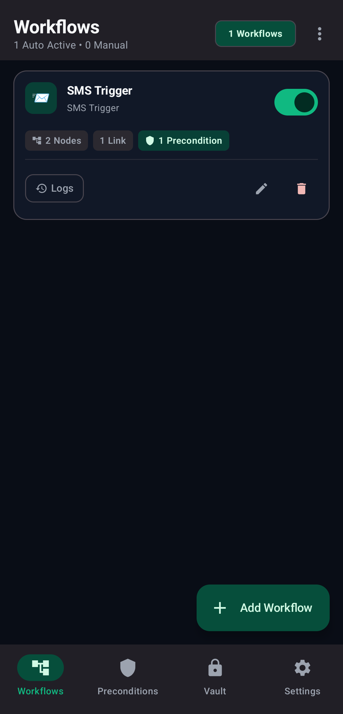
  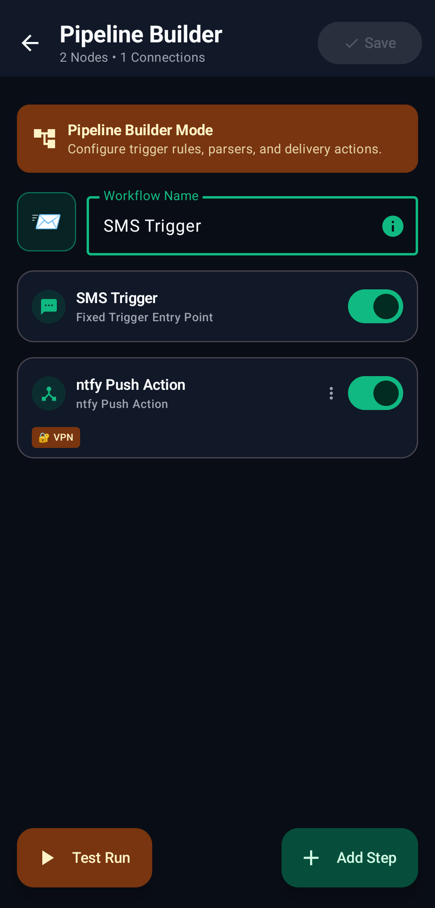
  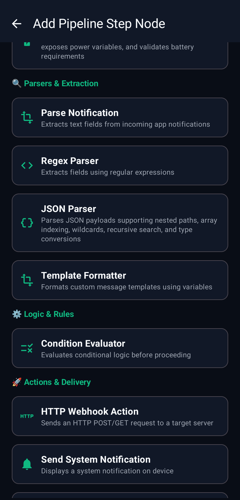
</p>

### Workflow Cards & Quick Controls
<p align="center">
  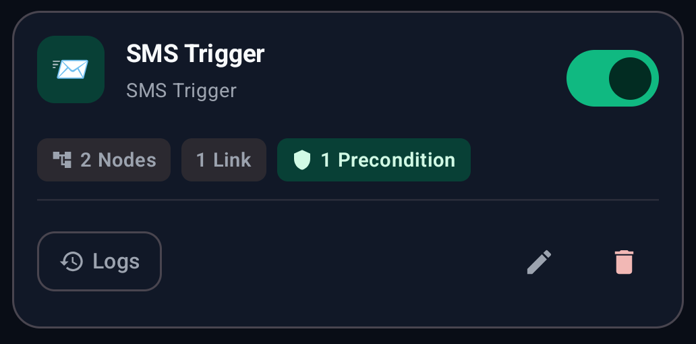
</p>

Each workflow card displays:
- **Active Toggle Switch**: Independently enable or pause automatic triggering without deleting the pipeline.
- **Metadata Chips**: Shows node count (`2 Nodes`), link count (`1 Link`), and attached precondition count (`1 Precondition`).
- **Quick Actions**: Open **Logs** (with live history & queue), **Edit** in the Pipeline Builder, or **Delete**.

### Pipeline Builder Features
<p align="center">
  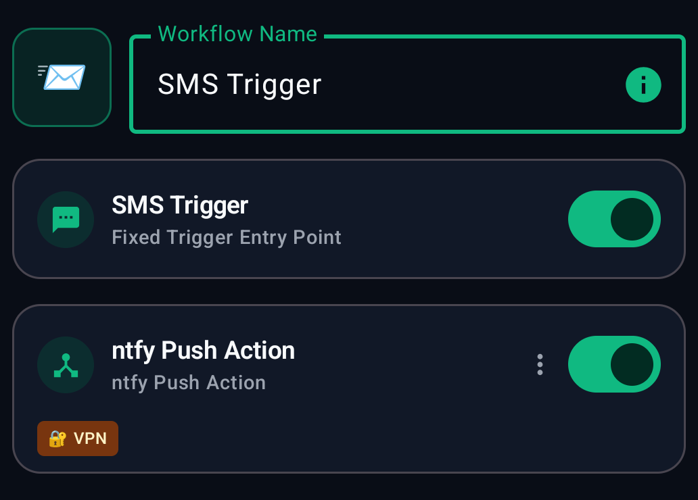
</p>

- **Conditional Branching**: Connections carry `outputPort` (`main`, `true`, `false`), allowing `Condition Evaluator` nodes to route true/false branches independently.
- **Per-Node Preconditions**: Attach any reusable Vault Precondition (e.g. `VPN`) or inline check directly onto individual steps.
- **Per-Node Failure Policies**:
  - `STOP_WORKFLOW`: Immediately halts downstream execution and records the failure.
  - `RETRY_WITH_BACKOFF`: Retries failed node execution automatically.
  - `CONTINUE_ON_FAILURE`: Logs the error and continues downstream nodes.
- **Dry-Run Test Mode**: Tap **Test Run** inside the Pipeline Builder using simulated trigger fields (`testSender`, `testBody`, `testPayload`, `testTitle`) to test your entire pipeline before enabling live triggers.

---

## 3. Complete Node Catalog (Triggers, Parsers, Logic & Actions)

### Triggers
| Node | `typeId` | Key Configuration | Output Variables |
| :--- | :--- | :--- | :--- |
| **SMS Trigger** | `dev.zophop.plugin.sms.SMS_TRIGGER` | Sender allowlist regex (`.*HDFCBK.*`), keyword filter regex, simulated `testSender` / `testBody`. | `sender`, `body`, `header`, `text` |
| **App Notification Trigger** | `dev.zophop.plugin.notification.NOTIFICATION_TRIGGER` | Target app package filter (comma-separated or `.*`), notification text regex, test fields. | `package_name`, `title`, `text`, `sender`, `body` |
| **Manual Action Trigger** | `MANUAL_TRIGGER` | Simulated event body JSON/text (`testBody`). | `body`, `text`, `timestamp` |
| **Cron Schedule Trigger** | `CRON_TRIGGER` | Interval or cron expression (`every 15m`, `hourly`, `daily`, `0 8 * * *`), simulated `testPayload`. | `body`, `text`, `sender`, `timestamp` |
| **Incoming Call Trigger** | `dev.zophop.plugin.call.CALL_TRIGGER` | Caller number regex filter (`.*555.*`). Requires `READ_PHONE_STATE`. | `caller_number`, `sender`, `header` |

### Parsers & Formatters
| Node | `typeId` | Capabilities | Output Variables |
| :--- | :--- | :--- | :--- |
| **Parse Notification** | `PARSE_NOTIFICATION` | Extracts fields from notification text using regex into a custom `outputKey`. | `code`, `otp`, or custom `outputKey` |
| **Regex Parser** | `REGEX_PARSER` | Extracts matched text, capture group 1, or named regex groups `(?<amount>...)` into `ExecutionContext`. | `code`, `otp`, `outputKey`, named groups |
| **JSON Parser** | `JSON_PARSER` | Extracts structured fields from `http_response`, `body`, or custom `inputVariable`. Strips Markdown code fences automatically. | `json_output`, `code`, `otp`, `outputKey` |
| **Template Formatter** | `TEMPLATE_FORMATTER` | Interpolates `${var}` and `{var}` tokens into reusable formatted payloads. | `formatted_payload`, `payload` |

#### JSON Parser Query Syntax
`JsonParserExecutor` supports rich path expressions and 8 target type conversions:
- **Nested & Bracket Keys**: `data.user.id`, `data['x-api-status']`
- **Array Indexing & Negative Indices**: `items[0].code`, `items[-1]` (last element), `matrix[0][1]`
- **Wildcard Projection**: `users[*].name`
- **Collection Lengths**: `items.length`, `items.size`, `items.count`
- **Recursive Deep Search**: `..otp` (finds the first non-null `otp` key at any depth)
- **Target Types (`targetType`)**: `AUTO`, `STRING`, `NUMBER`, `DOUBLE`, `BOOLEAN`, `JSON_STRING`, `COUNT`, `ARRAY` (with `defaultValue` fallback).

### Logic & Hardware / Network Checks
- **Condition Evaluator (`CONDITION`)**: Branches execution onto `"true"` or `"false"` output ports. Supported operators:
  - String: `EQUALS` (`==`), `NOT_EQUALS` (`!=`), `CONTAINS`, `NOT_CONTAINS`, `STARTS_WITH`, `ENDS_WITH`, `REGEX_MATCH`, `NOT_REGEX_MATCH`
  - Presence: `NOT_EMPTY`, `IS_EMPTY`
  - Numeric: `GREATER_THAN` (`>`), `GREATER_THAN_OR_EQUAL` (`>=`), `LESS_THAN` (`<`), `LESS_THAN_OR_EQUAL` (`<=`)
- **VPN Condition Check (`VPN_CHECK`)**: Inspects active VPN transport/interfaces (`tun`, `wg`, `tailscale`). Outputs `vpn_connected`, `vpn_interface`, `vpn_type`.
- **GPS / Location Condition Check (`GPS_CHECK`)**: Verifies location services and captures coordinates. Outputs `gps_enabled`, `latitude`, `longitude`, `accuracy`, `maps_url`, `location_provider`.
- **Internet & Network Check (`INTERNET_CHECK`)**: Verifies active Internet and optional transport (`ANY`, `WIFI`, `CELLULAR`). Outputs `internet_connected`, `network_type`, `is_metered`.
- **Bluetooth Condition Check (`BLUETOOTH_CHECK`)**: Inspects Bluetooth power, bonded devices, and optional target device name filter. Outputs `bluetooth_enabled`, `bluetooth_connected`, `connected_device_name`, `connected_device_address`, `bonded_device_count`.
- **SIM Card Condition Check (`SIM_CHECK`)**: Inspects SIM ready state and optional carrier name filter (`Jio`, `Airtel`, `T-Mobile`). Outputs `sim_ready`, `carrier_name`, `sim_count`, `is_roaming`.
- **Battery & Power Check (`BATTERY_CHECK`)**: Validates minimum battery percentage and optional charging requirement. Outputs `battery_percent`, `is_charging`, `charging_status`.

### Actions & Delivery
| Node | `typeId` | Capabilities | Output / Notes |
| :--- | :--- | :--- | :--- |
| **ntfy Push Action** | `dev.zophop.plugin.ntfy.NTFY_ACTION` | Delivers to ntfy.sh or self-hosted ntfy with topic, priority (`1–5`), title, tags, and `NTFY_AUTH` / `BEARER_TOKEN` Vault credentials. | Structured redacted request/response logs |
| **Gotify Push Action** | `dev.zophop.plugin.gotify.GOTIFY_ACTION` | Delivers to Gotify servers with priority (`1–10`) and `X-Gotify-Key` (`GOTIFY_AUTH`) Vault credentials. | Structured redacted request/response logs |
| **HTTP Webhook Action** | `HTTP_ACTION` | `GET`, `POST`, `PUT`, `PATCH`, `DELETE`, `HEAD` with query params, headers, `JSON`/`FORM_DATA`/`RAW`/`NONE` body, expected status code, Vault credential attachment, and **Import from cURL**. | `http_response`, `http_status` |
| **Send System Notification** | `SEND_NOTIFICATION_ACTION` | Displays a local Android notification using `${variable}` title & content templates. | Requires `POST_NOTIFICATIONS` on Android 13+ |
| **Send SMS Action** | `dev.zophop.plugin.sms.SEND_SMS_ACTION` | Sends an outbound SMS via device SIM using recipient & body templates. | Requires `SEND_SMS` |
| **Get Current Location** | `dev.zophop.plugin.gps.GET_LOCATION_ACTION` | Fetches GPS/Network/Passive coordinates and Google Maps URL. | `latitude`, `longitude`, `accuracy`, `maps_url` |
| **Disconnect / Answer Call** | `dev.zophop.plugin.call.DISCONNECT_CALL_ACTION` / `ANSWER_CALL_ACTION` | Rejects or answers incoming calls paired with `CALL_TRIGGER` (Android 9.0+). | `call_status` |
| **Telegram Notification** *(External APK)* | `dev.zophop.plugin.telegram.TELEGRAM_ACTION` | Sends formatted messages to Telegram chats/channels via `@BotFather` token (`TELEGRAM_AUTH`). | Install `ZopHop-Telegram-Plugin-v3.1.2.apk` |
| **Send Email (SMTP)** *(External APK)* | `dev.zophop.plugin.smtp.SMTP_ACTION` | Sends plain-text or HTML emails via STARTTLS, SMTPS, or Plain SMTP (`SMTP_AUTH`). | Install `ZopHop-SMTP-Plugin-v3.1.2.apk` |

---

## 4. HTTP Webhook Action & Import from cURL

The **HTTP Webhook Action** editor includes dynamic `${variable}` quick-insert chips, secret field masking toggles, Vault credential adapters (automatically attaching `Authorization` or `X-Gotify-Key`), and one-tap **Import from cURL**.

<p align="center">
  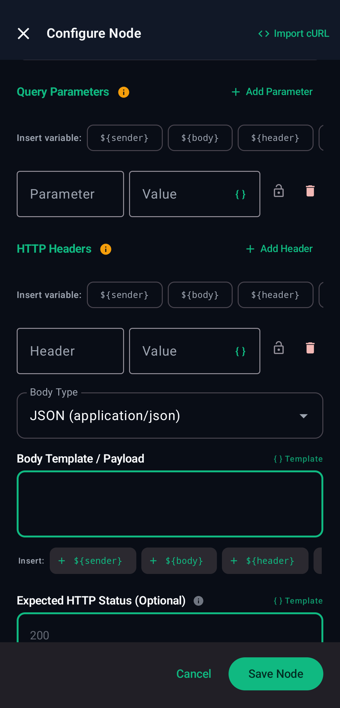
  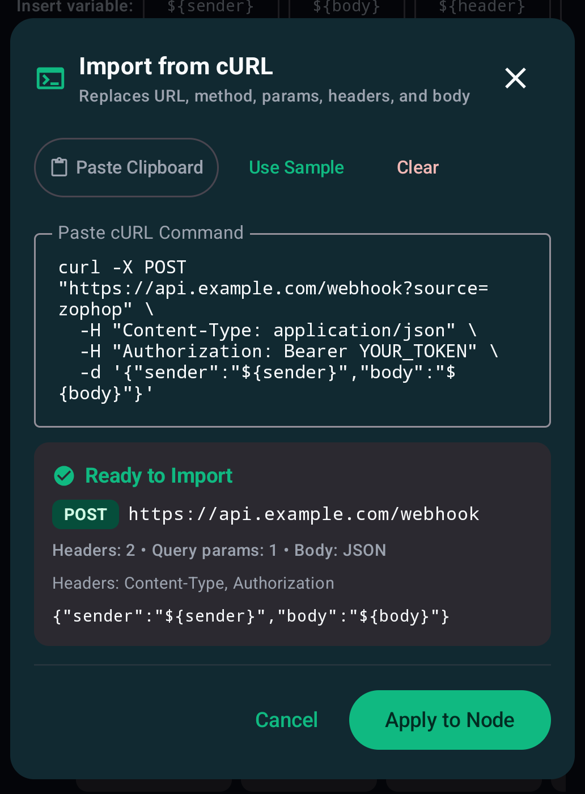
</p>

`CurlCommandParser` parses standard `curl` commands (including clipboard paste and a built-in **Use Sample** preview) supporting:
- Methods: `-X` / `--request` (auto-infers `POST` when body flags are supplied, or `GET` with `-G`)
- Headers & Auth: `-H` / `--header`, `-u user:pass` (Basic Auth), `-A` (`User-Agent`), `-b` (`Cookie`), `-e` (`Referer`)
- Payloads & Query Strings: `-d` / `--data` / `--data-raw` / `--data-binary` / `-F` and URL query parameters (`?source=zophop`)
- Automatic preview card showing parsed HTTP method, base URL, header count, query parameter count, body type (`JSON`, `FORM_DATA`, `RAW`), and payload preview before applying.

---

## 5. Preconditions & Chained Check Pipelines

Preconditions guard workflows or individual nodes so executions never fail blindly when your VPN is disconnected or your self-hosted server is asleep.

<p align="center">
  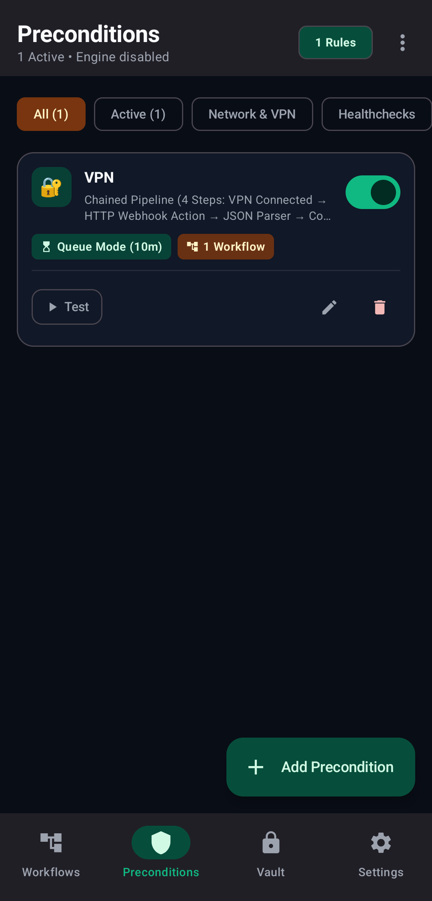
  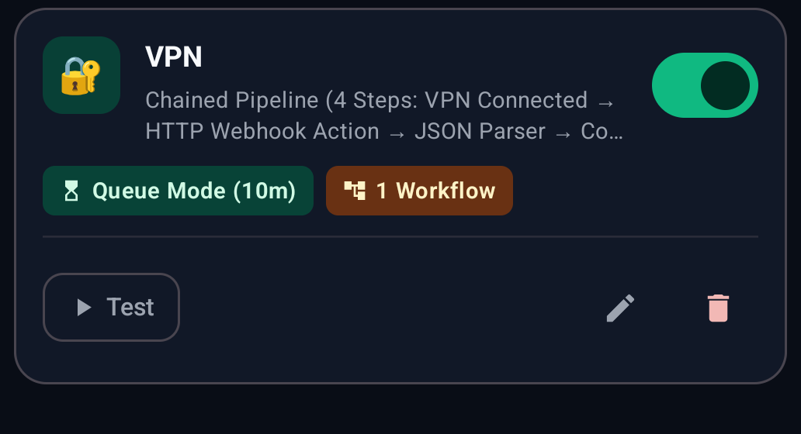
</p>

### 7 Precondition Types
| Type | What It Evaluates |
| :--- | :--- |
| **Internet Check** (`INTERNET_CHECK`) | Active cellular, Wi-Fi, or Ethernet connectivity. |
| **VPN Check** (`VPN_CHECK`) | Active `TRANSPORT_VPN` or virtual interface (`tun0`, `wg`, `tailscale`). |
| **Health Check** (`HEALTH_CHECK`) | Pre-flight `GET`/`HEAD`/`POST` probe to a URL with custom headers and expected HTTP status. |
| **SIM Check** (`SIM_CHECK`) | Active SIM readiness, optional carrier name (`Jio`, `Airtel`, etc.), and slot index. |
| **GPS Check** (`GPS_CHECK`) | Verifies device location hardware is enabled. |
| **Battery Check** (`BATTERY_CHECK`) | Minimum battery percentage threshold and optional charging requirement. |
| **Chained Pipeline** (`CHAINED_CHECK`) | Executes a full multi-step sub-workflow (e.g., `VPN Connected → HTTP Health Probe → JSON Parser → Condition Evaluator`) as a single reusable precondition! |

### Failure Policies & Backoff Strategies
Every precondition defines what happens when a check does not pass:
- **`FAIL_IMMEDIATELY`**: Aborts execution and records the failure reason.
- **`RETRY`**: Retries up to `maxRetries` times using `retryIntervalSeconds` and one of 4 backoff strategies (`calculateRetryDelaySeconds`):
  - `FIXED`: Constant delay (`baseIntervalSeconds`)
  - `LINEAR`: `baseIntervalSeconds * attempt`
  - `EXPONENTIAL`: `baseIntervalSeconds * 2^(attempt - 1)`
  - `RANDOMIZED`: Full-jitter random delay between `1` and the exponential ceiling
- **`QUEUE`**: Parks the execution in ZopHop's background queue until the condition is satisfied or `queueTimeoutMinutes` expires.

> **Inline Testing & Safe Cancellation**: Tap **Test** on any precondition card to watch live step progress. Ongoing precondition or workflow runs can be cancelled safely via the **Cancel Execution Confirmation** dialog (`CancelExecutionConfirmDialog`) so accidental taps never abort active runs prematurely.

---

## 6. Execution Logs, Live Stepper, Queue & Cancellation

<p align="center">
  
  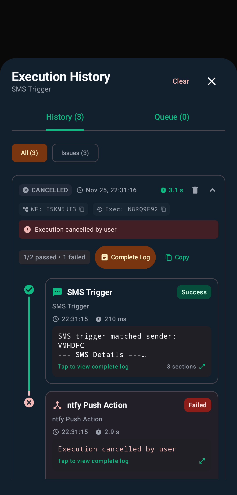
</p>

<p align="center">
  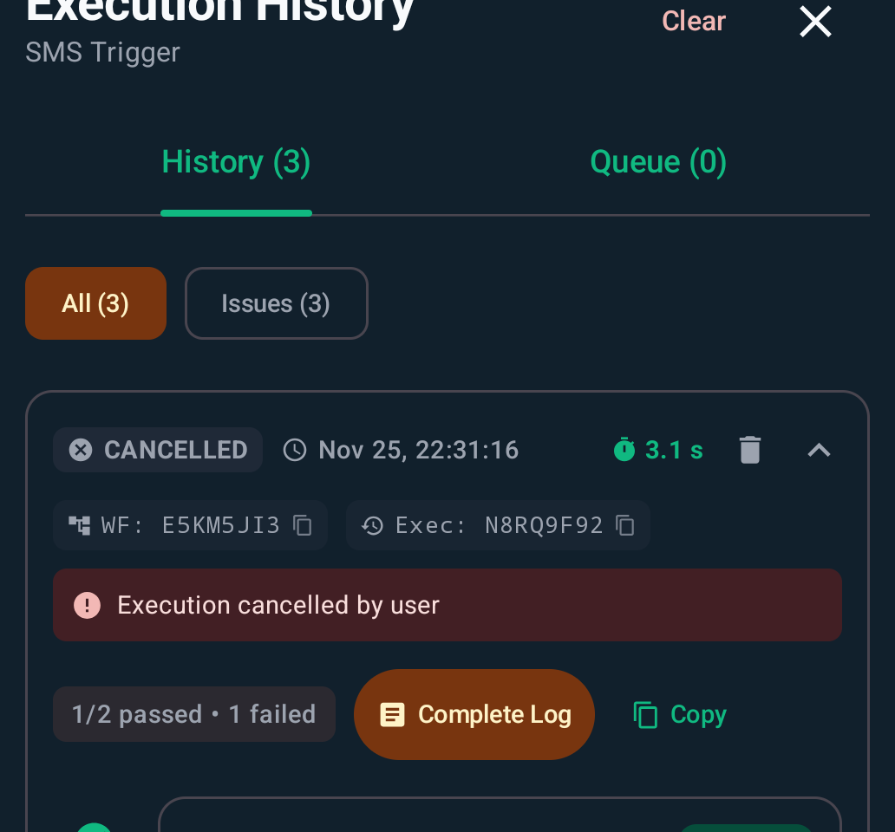
  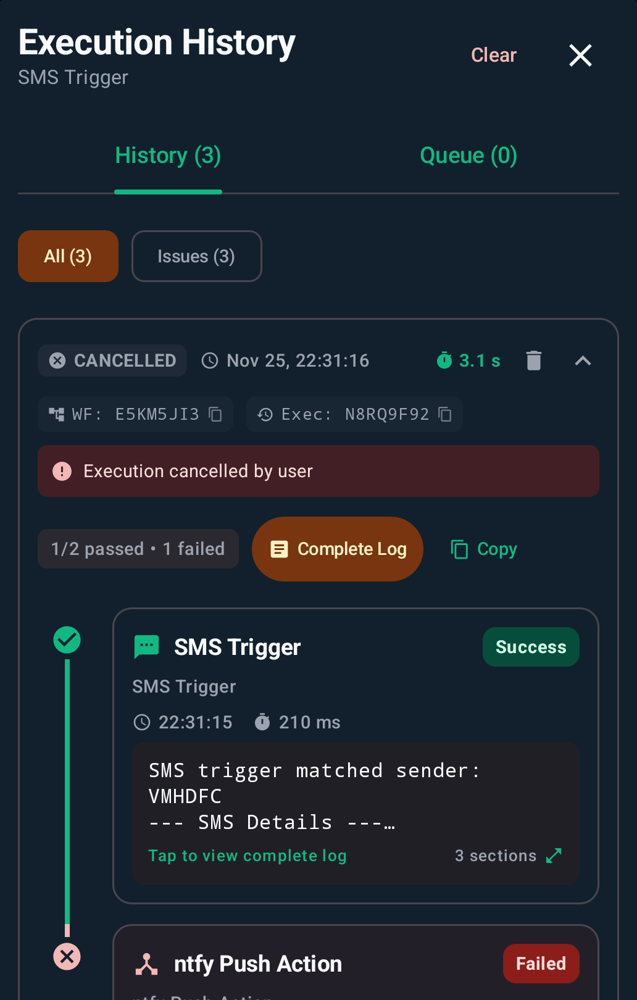
</p>

- **Live `NodeExecutionStepper`**: Displays per-step status (`PENDING`, `RUNNING`, `SUCCESS`, `FAILED`, `IGNORED`), millisecond timings, and expandable step summaries.
- **Complete Execution Log Modal**:
  - Filter steps by **All**, **Passed**, or **Errors**.
  - Inspect total execution duration, **WF ID** (`WF: 86C5Q60V`), and **Execution ID** (`Exec: 24b2ec28`) with one-tap copy.
  - Structured redacted sections (`--- Request ---`, `--- Headers ---`, `--- Body ---`, `--- Response ---`) automatically mask sensitive headers (`Authorization: Bearer ***`, `X-Gotify-Key: ***`, tokens, cookies).
  - **Copy All** exports the full execution trace to clipboard for debugging.
- **Background Queue Management**:
  - Queued runs appear in the **Queue** tab with actions to **Process Now**, **Retry from Failed Node**, or **Cancel** (with confirmation dialog).
- **Quick Settings Tile & Status Notifications**:
  - Add the **SMS Automations** Quick Settings tile (`WorkflowsTileService`) to toggle global automations from your notification shade.
  - Foreground status alerts notify on waiting preconditions, active execution, delivery success, or direct cancellation via `WorkflowCancelReceiver`.

---

## 7. Encrypted Credential Vault & Biometric Lock

<p align="center">
  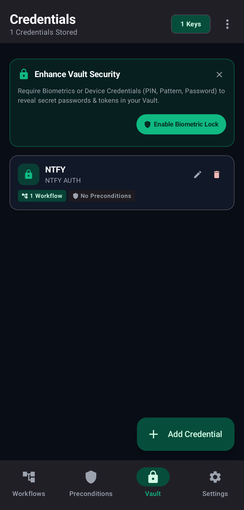
  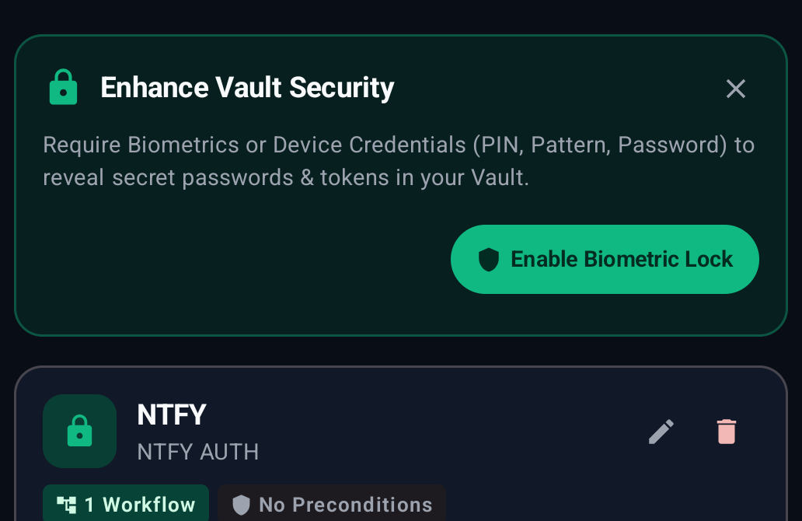
</p>

### Built-In & Plugin Credential Types
| Type | Stored Fields | Where Used |
| :--- | :--- | :--- |
| `BEARER_TOKEN` | `token` | HTTP Webhooks (`Authorization: Bearer ...`), ntfy.sh, fallback for custom plugins |
| `BASIC_AUTH` | `username`, `password` | HTTP Webhooks, reverse proxies (`Authorization: Basic ...`) |
| `HEADER_SET` | `headers` (multiline `Key: Value`) | Custom API keys, Cloudflare Access headers |
| `NTFY_AUTH` | `serverUrl`, `topic`, `token` | ntfy Push Action & HTTP Webhook adapter |
| `GOTIFY_AUTH` | `serverUrl`, `appToken` | Gotify Push Action & HTTP Webhook adapter (`X-Gotify-Key`) |
| Plugin Specs (e.g. `TELEGRAM_AUTH`, `SMTP_AUTH`) | Defined dynamically by plugins | Discovered automatically via `CredentialSpecRegistry` |

- **Hardware Encryption**: Stored via AES-256 GCM `EncryptedSharedPreferences` backed by Android KeyStore `MasterKey`.
- **Biometric / Device Lock Protection**: Enabling **Lock Credentials with Device Lock** requires Fingerprint, Face Unlock, or Device PIN/Pattern (`BiometricAuthHelper`) before revealing secret values or toggling security settings.
- **Usage Tracking**: Every Vault card displays usage badges (e.g. `1 Workflow`) so you know which pipelines depend on a credential before editing or deleting it.

---

## 8. Settings, Themes, Concurrency & Portable Backups

<p align="center">
  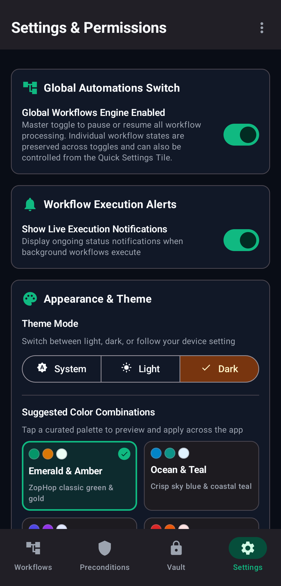
  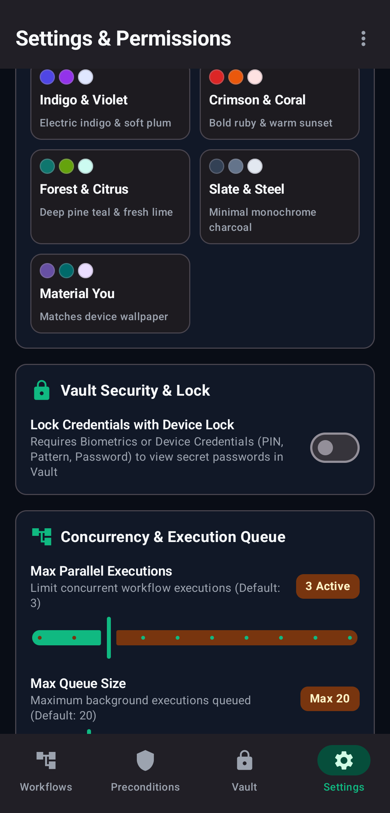
  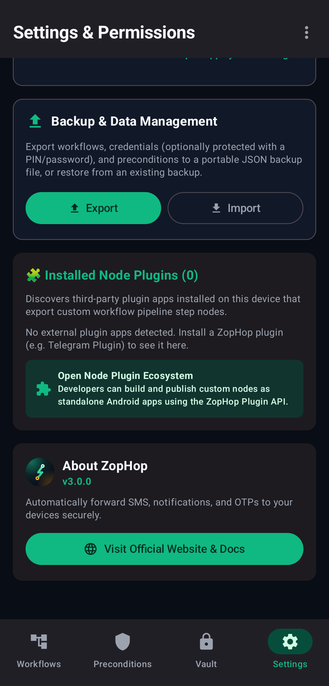
</p>

### Appearance & Theme Palettes (7 Themes)
<p align="center">
  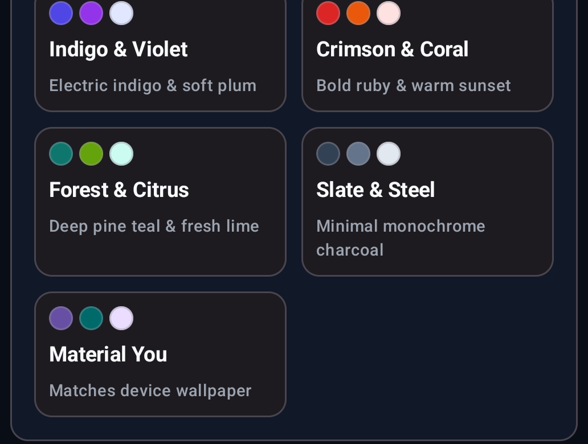
</p>

Switch between **System**, **Light**, and **Dark** modes and pick from 6 curated palettes plus **Material You** (Android 12+ dynamic wallpaper theming):
- **Emerald & Amber** *(ZopHop classic)*
- **Ocean & Teal**
- **Indigo & Violet**
- **Crimson & Coral**
- **Forest & Citrus**
- **Slate & Steel**
- **Material You** *(Matches device wallpaper)*

### Concurrency & Execution Queue Tuning
<p align="center">
  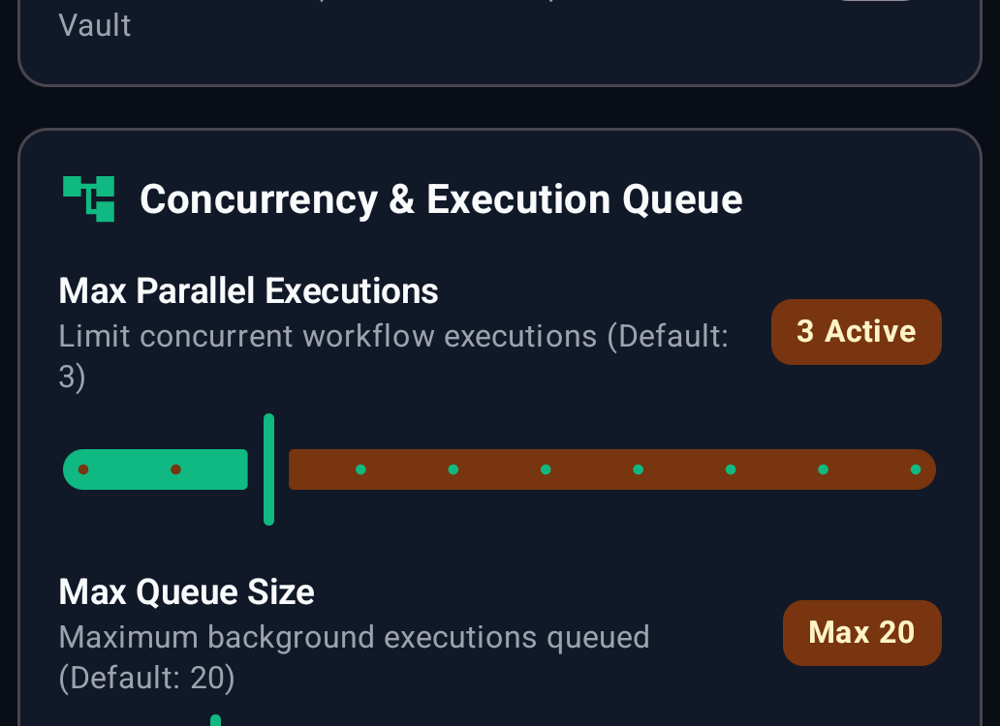
</p>

- **Max Parallel Executions**: `1–10` concurrent runs (Default: `3`).
- **Max Queue Size**: `5–100` background queued runs (Default: `20`).
- **Queue Expiry Timeout**: `1–60` minutes before waiting executions expire (Default: `10m`).

### Backup & Data Management + Installed Node Plugins
<p align="center">
  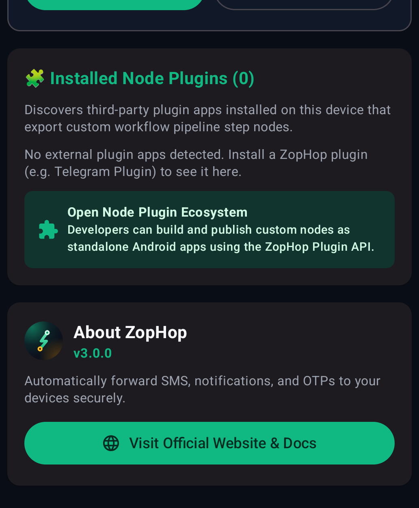
</p>

- **Selective Export & Dependency Auto-Resolution**: Choose specific workflows, and ZopHop automatically bundles referenced Vault credentials and Precondition rules (`Auto-Include Dependencies`), or optionally exports all credentials and rules.
- **Password-Encrypted Backups**: Toggle **Encrypt Secrets with Password** to encrypt credential secrets with PBKDF2/AES so backups can be safely transferred across devices.
- **Import Conflict Resolution**: When restoring via **Save to File**, **Copy**, or **Share**, choose between `OVERWRITE`, `KEEP_BOTH`, or `SKIP_EXISTING`.
- **App Permissions & Plugin Discovery**: View and grant built-in permissions (`RECEIVE_SMS`, `SEND_SMS`, `ACCESS_FINE_LOCATION`, `READ_PHONE_STATE`, `BLUETOOTH_CONNECT`, `POST_NOTIFICATIONS`, Notification Listener, Battery Optimization) and inspect installed external node plugins.

---

## 9. First-Time Setup & Self-Hosted Server Guides

### Step 1: Install Signed APKs
1. Download `ZopHop-v3.1.2.apk` (and optionally `ZopHop-Telegram-Plugin-v3.1.2.apk` / `ZopHop-SMTP-Plugin-v3.1.2.apk`) from [GitHub Releases](https://github.com/aman400/zophop/releases).
2. Install on Android 8.0 (API 26) or higher.
   - If Google Play Protect prompts on sideloaded builds, tap **More details** → **Install anyway**.

### Step 2: Grant Permissions & Battery Exemption
Open **Settings & Permissions**:
1. Grant **Receive SMS** (`RECEIVE_SMS`) and/or **Read App Notifications** (`BIND_NOTIFICATION_LISTENER_SERVICE`).
2. Grant **Show Notifications** (`POST_NOTIFICATIONS`) on Android 13+.
3. Set Battery Optimization to **Unrestricted / Don't Optimize**.

### Step 3: Optional Self-Hosted Server Setup

#### ntfy (Docker Compose + ACLs)
```yaml
version: '3.8'
services:
  ntfy:
    image: binwiederhier/ntfy
    container_name: ntfy
    command: ["serve"]
    volumes:
      - ./ntfy:/var/lib/ntfy
    environment:
      NTFY_BASE_URL: https://ntfy.example.com
      NTFY_CACHE_FILE: /var/lib/ntfy/cache.db
      NTFY_AUTH_FILE: /var/lib/ntfy/auth.db
      NTFY_AUTH_DEFAULT_ACCESS: deny-all
    ports:
      - "8080:80"
    restart: unless-stopped
```
```bash
ntfy user add publisher
ntfy access publisher "otp-*" write-only
ntfy token add publisher
```

#### Gotify (Docker Compose)
```yaml
version: '3.8'
services:
  gotify:
    image: gotify/server:latest
    container_name: gotify
    restart: unless-stopped
    volumes:
      - ./gotify_data:/app/data
    ports:
      - "8081:80"
```
In Gotify Web UI → **Apps** → **Create Application** `ZopHop` → copy the generated `X-Gotify-Key` into ZopHop's Vault (`GOTIFY_AUTH`).

---

## 10. Indian Banking & OTP Filter Presets

| Bank / Service | Sender Pattern | Extraction Regex | Template Payload |
| :--- | :--- | :--- | :--- |
| **HDFC Bank** | `.*HDFCBK.*` | `\b\d{6}\b` | `[${sender}] OTP: ${code}` |
| **ICICI Bank** | `.*ICICIB.*` | `\b\d{6}\b` | `[${sender}] OTP: ${code}` |
| **SBI** | `.*SBINBK.*` | `\b\d{6}\b` | `[${sender}] OTP: ${code}` |
| **Axis Bank** | `.*AXISBK.*` | `\b\d{6}\b` | `[${sender}] OTP: ${code}` |
| **Google 2FA** | `Google` | `G-(\d{6})` | `[Google] Code: ${code}` |

---

## 11. Testing with ADB Emulator

Simulate incoming SMS messages on an Android Emulator:
```bash
adb emu sms send VM-HDFCBK "Your OTP for transaction of Rs 500 is 482910."
adb emu sms send Google "G-884920 is your Google verification code."
```

Inspect plugin discovery logs:
```bash
adb logcat -s ExternalPluginRegistry:W ExternalPluginExecutor:W
```

---

## 12. Troubleshooting & OEM Battery Settings

To prevent aggressive OEM task killers from delaying background receivers:
- **Xiaomi / POCO (MIUI & HyperOS)**: **Security App → Permissions → Autostart → Enable ZopHop**; **Settings → Apps → Manage Apps → ZopHop → Battery Saver → No Restrictions**; lock ZopHop in Recents.
- **Samsung (One UI)**: **Settings → Battery and Device Care → Background Usage Limits → Never Sleeping Apps → Add ZopHop**.
- **OnePlus / Oppo / Realme (OxygenOS & ColorOS)**: **Settings → Apps → ZopHop → Battery Usage → Allow Background Activity & Allow Auto Launch**.
- **Pixel / Stock Android**: **Settings → Apps → ZopHop → App battery usage → Unrestricted**.

---

## 13. Security, Privacy & Data Hardening

1. **Hardware-Backed Encryption**: Vault secrets use AES-256 GCM `EncryptedSharedPreferences` with Android KeyStore `MasterKey`.
2. **Screen Protection (`FLAG_SECURE`)**: Release builds block screenshots and screen recordings across the app.
3. **Log Redaction**: `ExecutionLogFormatter` automatically redacts `Authorization`, `X-Gotify-Key`, `X-API-Key`, `Cookie`, and token/secret headers in execution logs.
4. **Zero Telemetry & Cloud Backup Opt-Out**: `android:allowBackup="false"` disables Google Drive auto-backup; no third-party analytics or ad SDKs are included.
5. **URL Credential Guard**: `HttpActionExecutor` rejects URLs containing embedded `user:pass@` credentials and redacts sensitive query parameters in logs.

---

## 14. Building Custom Plugins (Plugin SDK)

ZopHop distributes `com.github.aman400.zophop:plugin-api:v3.1.2` and `com.github.aman400.zophop:core-model:v3.1.2` publicly via JitPack (and as standalone `.aar` files on GitHub Releases) so anyone can create custom Trigger, Parser, Logic, or Action nodes as standalone Android APKs.

For full interactive documentation of all bridges (`INodePluginService.aidl`, `NodePluginModule`, `NodeExecutor`, `HttpCredentialAdapter`, `ExecutionContext`, `ExecutionLogFormatter`), models (`NodePluginManifest`, `ConfigFieldSpec`, `CredentialSpec`), caller verification, and a **complete step-by-step Slack Notification Plugin example**, open **[docs/plugins.html](docs/plugins.html)** ([Online HTML Docs](https://aman400.github.io/zophop/plugins.html)).
