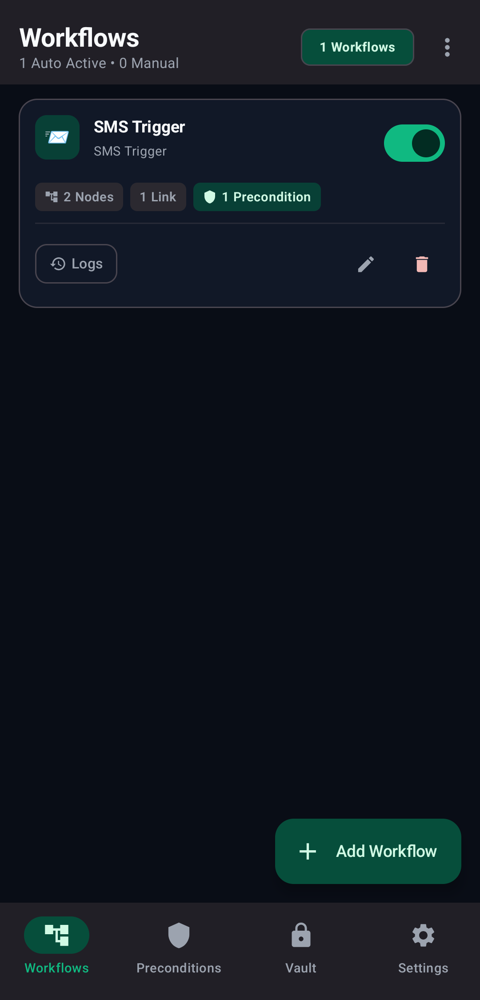
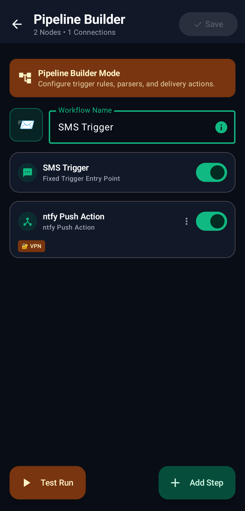
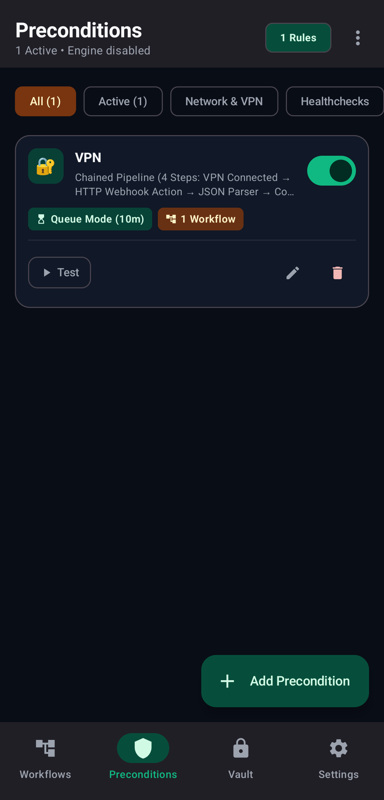
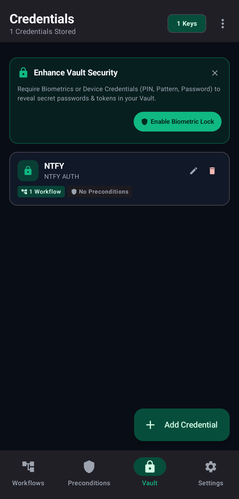
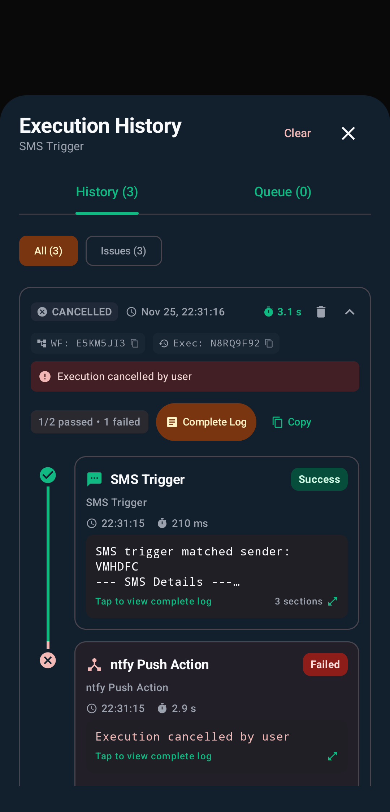
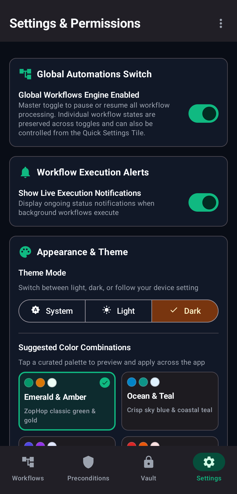
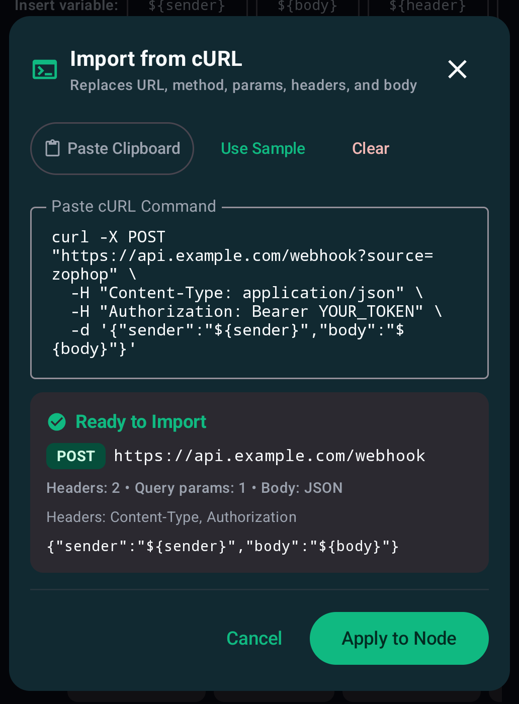
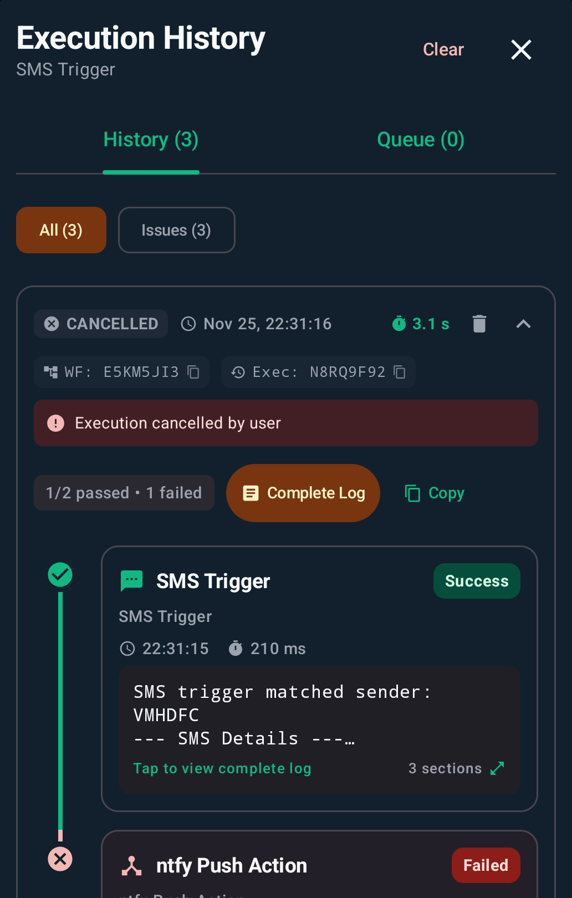

# ZopHop — Visual Workflow, OTP Forwarding & Android Automation Engine

[](https://github.com/aman400/zophop/releases)
[-34d399?style=flat-square)](https://developer.android.com)
[](https://kotlinlang.org)
[](LICENSE)

**ZopHop** (`dev.zophop`) is an open-source, privacy-first Android automation and notification forwarding platform built in Kotlin and Jetpack Compose. It captures incoming SMS messages, app notifications, phone calls, and cron schedules; verifies network, VPN, hardware, and chained pipeline preconditions; runs visual workflow graphs with Regex/JSON parsing and conditional branching; and delivers payloads to **ntfy**, **Gotify**, **HTTP webhooks (with cURL import)**, **SMS**, **Telegram & Email (SMTP) (via external plugins)**, or your own **custom AIDL plugins**.

It is engineered for personal automation, home-lab owners, and self-hosters operating servers behind private VPNs (Tailscale, WireGuard) or strict on-device security constraints.

---

## Visual Showcase

| Workflows & Triggers | Visual Pipeline Builder | Preconditions & Chains |
| :---: | :---: | :---: |
|  |  |  |

| Biometric Encrypted Vault | Live Stepper & Execution Logs | Themes & Appearance |
| :---: | :---: | :---: |
|  |  |  |

<p align="center">
  
  &nbsp;&nbsp;
  
</p>

---

## Key Features (v3.1.0)

### 1. Visual Workflow Engine & 20+ Built-In Nodes
- **4 Trigger Types**: SMS Message (`*sender*`, keyword regex), App Notification (package name + title/body match), Manual Trigger, and Cron Schedule (6 presets + custom 5-field cron).
- **Parsers & Logic**:
  - **Regex Parser**: Named/numbered capture groups (`${code}`, `${otp}`, `${group1}`) with fallback defaults.
  - **JSON Parser**: Extracts values using dot paths (`data.user.id`), array/negative indexing (`items[-1].code`), wildcards (`items[*].id`), recursive descent (`..code`), and 8 typed targets (`STRING`, `INTEGER`, `DECIMAL`, `BOOLEAN`, `JSON_OBJECT`, `JSON_ARRAY`, `ARRAY_LENGTH`, `EXISTS`).
  - **Condition Evaluator**: 14 comparison operators (`EQUALS`, `NOT_EQUALS`, `CONTAINS`, `REGEX_MATCH`, `GREATER_THAN`, `IS_EMPTY`, etc.) with case-sensitivity toggle.
- **Hardware & Context Checks**: VPN active check, GPS enabled check, Internet connectivity, Bluetooth status, Cellular/SIM readiness, Battery level threshold.
- **Action & Delivery Nodes**: **ntfy Push**, **Gotify Push**, **HTTP Webhook** (with one-tap **cURL Command Import**), **System Notification**, **Send SMS**, **Get GPS Location**, **Answer / Disconnect Phone Call**, plus **External AIDL Plugins** (`Telegram Bot`, `SMTP Email`, or custom 3rd-party plugins).

### 2. Preconditions, Chained Pipelines & Backoff Retries
- **7 Reusable Precondition Types**: Internet Connected, VPN Active, Bluetooth Enabled, Battery Level, HTTP Healthcheck Probe, Carrier SIM Status, and **Chained Pipelines** (`PRECONDITION_CHAIN` with circular dependency detection).
- **Failure Policies & Retries**: Configure `FAIL_IMMEDIATELY`, `RETRY`, or `QUEUE`, with 4 backoff strategies (`FIXED`, `LINEAR`, `EXPONENTIAL`, `EXPONENTIAL_JITTER`) and up to 20 retry attempts.

### 3. Real-Time Execution Stepper & Queue Control
- **Live Step-by-Step Progress**: Inspect every running, queued, and historical workflow node execution in real time, plus view full JSON/payload details in the **Complete Execution Log** modal.
- **Safe Cancellation**: Built-in confirmation dialog prevents accidental cancellation of active or queued runs.
- **Tunable Engine Concurrency**: Adjust max parallel workers (`1–10`) and max queued executions (`5–100`) right from Settings.

### 4. Privacy, Vault & Customization
- **Hardware-Backed Encrypted Vault**: Store `BEARER_TOKEN`, `BASIC_AUTH`, `HEADER_SET`, `NTFY_AUTH`, `GOTIFY_AUTH`, and `CUSTOM_SECRET` credentials using `EncryptedSharedPreferences` (AES-256-GCM + Android KeyStore), guarded by **BiometricPrompt** / device lock and `FLAG_SECURE`.
- **Zero Plaintext Secret Leakage**: Vault secrets are resolved only at execution time and masked from logs.
- **7 Color Palettes & Material You**: Emerald, Ocean, Sunset, Amethyst, Crimson, Midnight, Forest, plus Android 12+ dynamic color and Light/Dark/System modes.
- **Selective & Password-Encrypted Backups**: Export/import workflows, preconditions, and vault credentials using PBKDF2-HMAC-SHA256 + AES-256-GCM `.zophop` archives.

### 5. External Plugin Ecosystem (AIDL IPC)
- Install external Android plugin APKs (such as the official **`ZopHop-Telegram-Plugin-v3.1.0.apk`** and **`ZopHop-SMTP-Plugin-v3.1.0.apk`**) or build your own plugin APK using `com.github.aman400.zophop:plugin-api:v3.1.0` (served publicly via JitPack and attached as `.aar` release assets).
- Plugins automatically appear inside ZopHop's Node Catalog and Settings → Plugins with package-signature security checks and automatic Vault credential injection.

---

## Documentation & Web Portal (HTML/CSS UI)

- **[Interactive Documentation Site](https://aman400.github.io/zophop)** — Full responsive HTML/CSS documentation portal with Dark/Light mode, search, copy buttons, and screenshot lightbox:
  - **[Overview & Visual Showcase](https://aman400.github.io/zophop/index.html)** ([docs/index.html](docs/index.html))
  - **[Complete User & Feature Manual](https://aman400.github.io/zophop/manual.html)** ([docs/manual.html](docs/manual.html))
  - **[Plugin SDK Reference & Slack Plugin Tutorial](https://aman400.github.io/zophop/plugins.html)** ([docs/plugins.html](docs/plugins.html))
  - **[Signed Release, External Plugins & AAR Publishing Guide](https://aman400.github.io/zophop/releases.html)** ([docs/releases.html](docs/releases.html))
- Offline Markdown reference mirrors: [DOCUMENTATION.md](DOCUMENTATION.md) • [RELEASE_GUIDE.md](RELEASE_GUIDE.md)

---

## Quick Build & Installation

### 1. Build Release APKs & Plugin SDK AARs
```bash
# Build ZopHop main APK and external plugin APKs (Telegram & SMTP)
./gradlew assembleRelease

# Build Plugin SDK AARs (plugin-api and core-model)
./gradlew :core:plugin-api:assembleRelease :core:model:assembleRelease
```
Generated outputs:
- Main app: `app/build/outputs/apk/release/ZopHop-v3.1.0.apk`
- Telegram plugin: `external/telegram/build/outputs/apk/release/ZopHop-Telegram-Plugin-v3.1.0.apk`
- SMTP Email plugin: `external/smtp/build/outputs/apk/release/ZopHop-SMTP-Plugin-v3.1.0.apk`
- SDK AARs: `core/plugin-api/build/outputs/aar/plugin-api-release.aar`, `core/model/build/outputs/aar/model-release.aar`

### 2. Install via ADB or Sideload
```bash
# Install main app and auto-grant permissions
adb install -r -g app/build/outputs/apk/release/ZopHop-v3.1.0.apk

# Optional: Install official external plugins (Telegram Bot & SMTP Email)
adb install -r external/telegram/build/outputs/apk/release/ZopHop-Telegram-Plugin-v3.1.0.apk
adb install -r external/smtp/build/outputs/apk/release/ZopHop-SMTP-Plugin-v3.1.0.apk
```

> **Bypassing Google Play Protect prompts on sideloaded builds**:
> - **Install Anyway**: Tap **"More details"** → **"Install anyway"** when prompted.
> - **Disable Scanning**: Open **Play Store → Profile → Play Protect → Settings → Toggle OFF Scan apps**.
> - **Dedicated Forwarder Device (ADB)**: `adb shell pm disable-user --user 0 com.android.vending`

---

## Testing on Android Emulator

Simulate incoming OTP SMS messages while running on an Android Emulator:

```bash
adb emu sms send VM-HDFCBK "Your OTP for transaction of Rs 500 is 482910."
```

Run the full unit test suite:

```bash
./gradlew test
```

---

## License

Released under the [MIT License](LICENSE).
